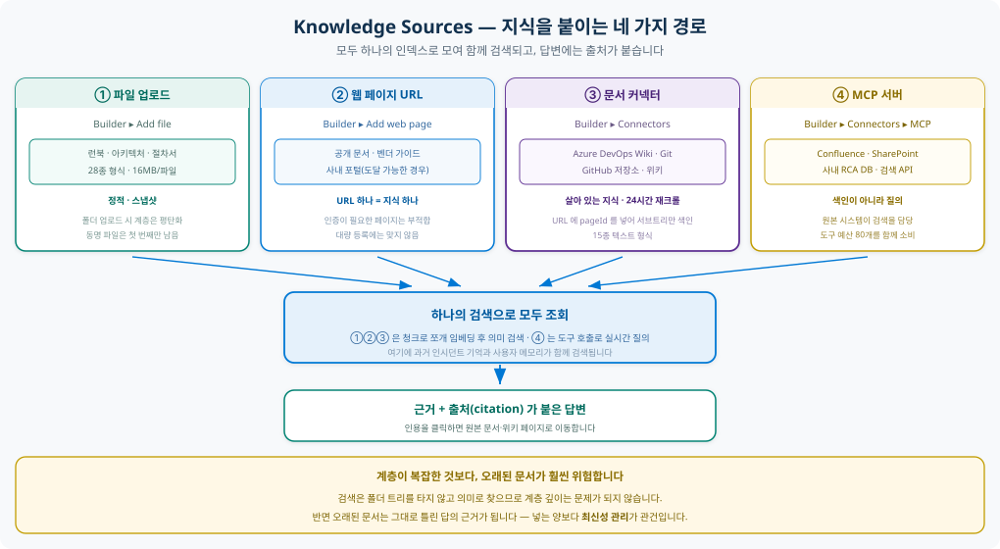
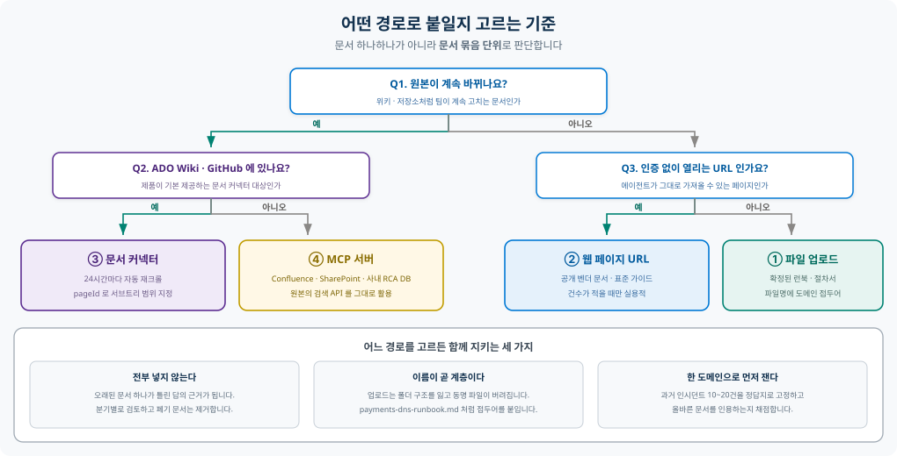
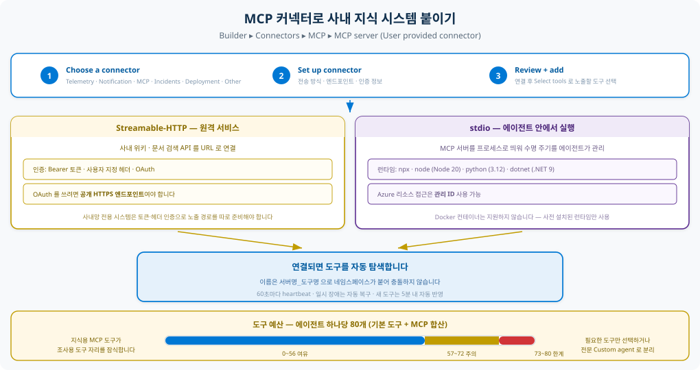
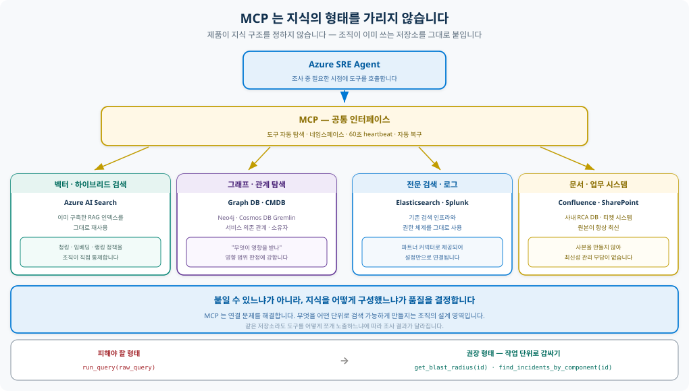
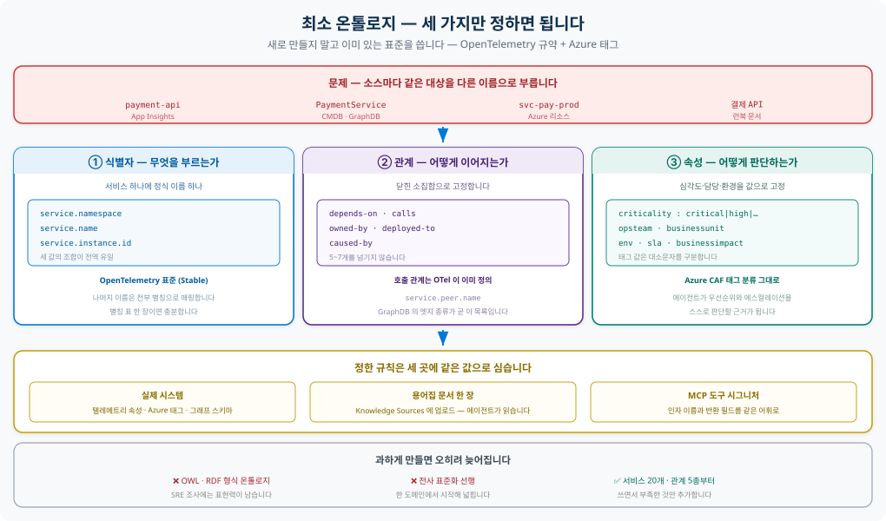

# 지식 구성 가이드 — Knowledge Sources

> 사내 지식을 SRE Agent 에 **어떻게 구성할지** 정리한 종합 가이드입니다.
> 런북·아키텍처 문서·과거 RCA 같은 문서는 물론,
> **구조화 데이터(CMDB · 서비스 카탈로그 · 티켓) · 벡터 검색(Azure AI Search) · 그래프 지식(GraphDB)**
> 까지 함께 다룹니다.
>
> 제품 기능 설명은 **[SRE Agent 기능 설명](SRE_Agent.md)**, 실제 적용 결과는 **[Portal 기능](features-sre/README.md)** 을 참고하세요.

포털에서 지식은 두 화면에 나눠져 있습니다.

| 화면 | 무엇을 등록하나 |
|---|---|
| **Builder ▸ Knowledge Sources** | 파일 업로드 · 웹 페이지 URL |
| **Builder ▸ Connectors** | 문서 커넥터(ADO Wiki 등) · **MCP 서버**(AI Search · GraphDB · CMDB …) |

> 저장소 연결은 **Code Access** 로 이동했습니다. Knowledge Sources 에서 코드 저장소를 찾지 마세요.

---

## 결론부터 — 다섯 문장 요약

1. 지식을 붙이는 경로는 **네 가지**입니다 — 파일 업로드 · 웹 페이지 URL · 문서 커넥터 · MCP 서버.
2. 앞의 셋은 문서를 색인해 **의미로 검색**하고, MCP 는 색인 없이 **원본에 질의**합니다.
3. 그래서 문서가 아닌 지식 — **AI Search 인덱스 · GraphDB · CMDB · 티켓 시스템** — 은 모두 MCP 로 붙습니다.
4. 경로 선택 기준은 하나입니다. **원본이 자주 바뀌면 연결하고, 안 바뀌면 올립니다.**
5. 어려운 건 연결이 아니라 **구성**입니다 — 검색 단위, 담당 경계, 이름 규칙을 정하는 일이 품질을 가릅니다.

바쁘시면 [1장 전체 지도](#1-지식-구성-전체-지도)와 [2장 판단 기준](#2-무엇을-어디에-붙일지-어떻게-정하나요)만 보셔도 됩니다.

> **어디까지 확실한가** — 문서 업로드와 자동 축적 메모리는 이 Lab 에서 **직접 확인**했습니다.
> 반면 AI Search · GraphDB · 사내 문서 시스템을 MCP 로 붙이는 건 **제품 문서에 근거한 설계안**이며,
> 사내 인증·네트워크 조건에 따라 결과가 달라집니다. 본문에 ✅ 🟡 🔬 로 구분해 표시했습니다.

---

## 목차

1. [지식 구성 전체 지도](#1-지식-구성-전체-지도)
2. [무엇을 어디에 붙일지 어떻게 정하나요](#2-무엇을-어디에-붙일지-어떻게-정하나요)
3. [웹 페이지 URL 은 언제 쓰나요](#3-웹-페이지-url-은-언제-쓰나요)
4. [MCP 커넥터는 어떻게 구성하나요](#4-mcp-커넥터는-어떻게-구성하나요)
5. [MCP 로는 어떤 형태의 지식이든 붙습니다 — AI Search · GraphDB](#5-mcp-로는-어떤-형태의-지식이든-붙습니다--ai-search--graphdb)
6. [소스가 여러 개면 이름이 충돌합니다 — 최소 온톨로지](#6-소스가-여러-개면-이름이-충돌합니다--최소-온톨로지)
7. [문서가 수천 건이면 어떻게 하나요](#7-문서가-수천-건이면-어떻게-하나요)
8. [과거 RCA 는 어떻게 다루나요](#8-과거-rca-는-어떻게-다루나요)
9. [효과는 어떻게 검증하나요](#9-효과는-어떻게-검증하나요)
10. [참고 자료](#10-참고-자료)

---

## 1. 지식 구성 전체 지도

지식 구성은 **두 가지를 같이** 정하는 일입니다 — 무엇을(지식의 형태) 어떻게(연결 경로) 붙일 것인가.
아래가 전체 조합입니다.

각 항목이 **지금 바로 구성 가능한지**, 아니면 **엔터프라이즈 적용 전에 확인이 필요한지**를 함께 표시했습니다.

| 표시 | 의미 |
|:--:|---|
| ✅ | **확인됨** — 제품 문서에 명시되어 있고, 이 Lab 에서 직접 동작을 보았습니다 |
| 🟡 | **문서 기준** — 제품 문서에 명시되어 있으나 이 Lab 에서는 검증하지 않았습니다 |
| 🔬 | **PoC 필요** — 구조상 가능하지만 사내 환경에서 먼저 검증해야 합니다 |

| 지식의 형태 | 대표 예 | 경로 | 검색 방식 | 성숙도 |
|---|---|---|---|:--:|
| 확정된 런북 · 절차서 | 장애 대응 문서, 조직 표준 | ① 파일 업로드 | 색인 → 의미 검색 | ✅ |
| 공개 참조 문서 | 벤더 가이드, 표준 문서 | ② 웹 페이지 URL | 색인 → 의미 검색 | 🟡 |
| 살아 있는 위키 | ADO Wiki, GitHub Wiki | ③ 문서 커넥터 | 색인 → 의미 검색 | 🟡 |
| **구조화 데이터 (스냅샷)** | 서비스 카탈로그 CSV, 자산 대장 XLSX, 설정 JSON/YAML | ① 파일 업로드 | 색인 → 의미 검색 | ✅ |
| **구조화 데이터 (라이브)** | **CMDB · ServiceNow·Jira 티켓 · SQL 테이블** | ④ MCP 서버 | 원본에 질의 | 🔬 |
| **시계열 · 로그 테이블** | **Azure Data Explorer (Kusto)** | 기본 커넥터 | **스키마 자동 학습** | 🟡 |
| **벡터 인덱스** | **Azure AI Search** (사내 RAG) | ④ MCP 서버 | 원본에 질의 | 🔬 |
| **그래프 지식** | **GraphDB** — Neo4j, Cosmos DB Gremlin, CMDB | ④ MCP 서버 | 원본에 질의 | 🔬 |
| 전문 검색 · 로그 | Elasticsearch, Splunk | ④ MCP 서버 (파트너) | 원본에 질의 | 🟡 |
| 문서 · 업무 시스템 | Confluence, SharePoint, 사내 RCA DB | ④ MCP 서버 | 원본에 질의 | 🔬 |
| 과거 인시던트 기억 | 증상 · 근본 원인 · 해결 단계 | — | **자동 축적** | ✅ |

> **이 표를 읽는 법** — ✅ 는 바로 진행하셔도 됩니다.
> 🟡 은 제품이 보장하는 기능이므로 구성 자체는 막히지 않지만, 동작 확인을 한 번 거치시는 편이 안전합니다.
> 🔬 는 **사내 시스템을 직접 연결해야 하는 영역**입니다. 기술적으로는 성립하지만
> 인증·네트워크·성능은 환경마다 달라서 [9장](#9-효과는-어떻게-검증하나요)의 소규모 검증을 먼저 권합니다.

> 사내 지식은 Confluence 같은 **문서**만 있는 게 아닙니다.
> 서비스 카탈로그, 자산 대장, 티켓 이력 같은 **구조화 데이터도 그대로 대상**입니다.
> 업로드는 `.csv` `.json` `.xlsx` `.yaml` `.xml` 등을 받으며, 라이브로 써야 하면 ④ 로 붙입니다.
> 둘 중 어느 쪽인지 판단하는 기준은 [5장](#5-mcp-로는-어떤-형태의-지식이든-붙습니다--ai-search--graphdb) 에 있습니다.

마지막 행이 중요합니다. 에이전트는 조사가 끝나면 30분 뒤에 증상·근본 원인·해결 단계·피해야 할 접근을
**스스로 색인**하고 같은 리소스의 과거 기록을 우선 검색합니다.
사람이 넣는 지식은 이 위에 얹히는 것이지 대체하는 것이 아닙니다.

### 연결 경로 네 가지

<p align="center">
  
</p>

| 경로 | 등록 위치 | 성격 | 갱신 |
|---|---|---|---|
| ① **파일 업로드** | Knowledge Sources ▸ Add file | 정적 스냅샷 | 사람이 다시 올려야 함 |
| ② **웹 페이지 URL** | Knowledge Sources ▸ Add web page | URL 하나 = 지식 하나 | 페이지 기준 |
| ③ **문서 커넥터** | Connectors ▸ Code Repository | 살아 있는 위키 | **24시간마다 자동 재크롤** |
| ④ **MCP 서버** | Connectors ▸ MCP | 색인이 아니라 **질의** — AI Search · GraphDB · CMDB | 항상 실시간 |

①②③ 는 문서를 **청크로 쪼개 임베딩한 뒤 의미 기반으로 검색**합니다.
④ 는 색인하지 않고 **원본 시스템의 검색을 도구로 호출**합니다.
이미 구축한 AI Search 인덱스나 GraphDB 를 그대로 쓸 수 있는 것도 이 때문입니다 → [5장](#5-mcp-로는-어떤-형태의-지식이든-붙습니다--ai-search--graphdb)

---

## 2. 무엇을 어디에 붙일지 어떻게 정하나요

<p align="center">
  
</p>

판단은 **문서 하나가 아니라 문서 묶음 단위**로 합니다.

| 이런 자료라면 | 이 경로 |
|---|---|
| 확정된 런북, 장애 대응 절차, 조직 표준 | ① 파일 업로드 |
| 공개 벤더 문서, 표준 가이드 — 건수가 적을 때 | ② 웹 페이지 URL |
| 팀이 계속 고치는 ADO Wiki · GitHub 위키 | ③ 문서 커넥터 |
| Confluence · SharePoint · 사내 RCA DB | ④ MCP 서버 |
| **벡터 인덱스 · 그래프 DB · CMDB** | ④ MCP 서버 |

**핵심은 "바뀌는가"입니다.** 자주 바뀌는 문서를 파일로 올리면 그 순간부터 사본이 낡기 시작하고, 낡은 문서는 그대로 **틀린 답의 근거**가 됩니다.

---

## 3. 웹 페이지 URL 은 언제 쓰나요

**Knowledge Sources ▸ Add web page** 로 URL 을 등록하면 그 페이지가 지식으로 색인됩니다.

**맞는 경우**

- 공개된 벤더 문서나 표준 가이드 (예: 프레임워크 공식 트러블슈팅 페이지)
- 사내 포털 중 **인증 없이 열리는** 안내 페이지
- 파일로 내려받기 애매한, 몇 건 안 되는 참조 문서

**맞지 않는 경우**

- **로그인이 필요한 페이지** — 에이전트가 가져오지 못합니다. 이 경우 커넥터나 MCP 로 가야 합니다
- **수백 건 이상의 대량 등록** — URL 을 하나씩 넣는 방식이라 운영 부담이 큽니다
- **자주 바뀌는 위키** — 같은 위키라면 문서 커넥터가 자동 동기화까지 해 줍니다

> 정리하면 웹 페이지 등록은 **소량의 공개 참조 문서를 빠르게 얹는 용도**입니다.
> 사내 지식의 본체를 여기에 태우려 하면 금방 한계에 부딪힙니다.

---

## 4. MCP 커넥터는 어떻게 구성하나요

먼저 알아둘 것 세 가지 — **전송 방식을 고르고, 인증을 정하고, 도구 예산을 계산**합니다.
이 중 도구 예산을 놓치면 나중에 조사용 도구를 붙이지 못합니다.

<p align="center">
  
</p>

**Builder ▸ Connectors ▸ MCP ▸ MCP server (User provided connector)** 에서 시작합니다.
커넥터 목록은 Telemetry · Notification · MCP · Incidents · Deployment · Other 로 분류되어 있습니다.

### 전송 방식 두 가지

| 방식 | 어떻게 붙나 | 사내 지식에 쓸 때 |
|---|---|---|
| **Streamable-HTTP** | 원격 URL 엔드포인트 | 사내 위키·문서 검색 API 를 MCP 로 감싸 노출 |
| **stdio** | 에이전트 컨테이너 안에서 프로세스 실행 | npm·Python 기반 MCP 서버를 직접 구동 |

`stdio` 는 사전 설치된 런타임만 씁니다 — `npx`/`node`(Node 20), `python`(3.12), `dotnet`(.NET 9).
**Docker 컨테이너는 지원하지 않습니다.**

### 인증

| 방법 | 쓰는 곳 |
|---|---|
| Bearer 토큰 | 대부분의 SaaS API |
| 사용자 지정 헤더 | 특정 헤더를 요구하는 API |
| OAuth | 규격을 따르는 원격 MCP 서버 — **공개 HTTPS 엔드포인트 필수** |
| 관리 ID | stdio 로 Azure 리소스에 접근할 때 |

> ⚠️ **사내망 전용 시스템은 여기서 막힙니다.** OAuth 는 공개 HTTPS 를 요구하고,
> 비공개 엔드포인트는 거부됩니다. 노출 경로(리버스 프록시·게이트웨이)와 토큰 발급을
> **사전에 설계**해야 합니다. 비공개 리소스 접근은 [VNet 통합](SRE_Agent.md#9-보안과-네트워크는-어떻게-통제하나요) 과 함께 검토하세요.

### 연결 이후

- 도구를 **자동 탐색**하고 `서버명_도구명` 으로 네임스페이스를 붙여 충돌을 막습니다
- **60초마다 heartbeat** 로 상태를 확인하고 일시 장애는 자동 복구합니다
- 서버에 새 도구가 생기면 **5분 내 자동 반영**됩니다

### 반드시 계산해야 할 것 — 도구 예산

에이전트 하나가 쓸 수 있는 도구는 **기본 도구와 MCP 도구를 합쳐 80개**입니다.
지식 조회용 MCP 도구를 무제한으로 붙이면 **조사용 도구 자리를 잠식**합니다.

| 도구 수 | 표시 | 의미 |
|--:|---|---|
| 0~56 | 파랑 | 여유 |
| 57~72 | 노랑 | 한계 근접 |
| 73~80 | 빨강 | 추가 불가 |

**대응 두 가지**

1. 커넥터 생성 시 **Select tools** 에서 실제로 쓸 도구만 고릅니다
2. 지식 조회를 **전문 Custom agent 로 분리**하고 그 에이전트에만 도구를 할당합니다
   (YAML 에서 `mcp_tools: [ "confluence-mcp/*" ]` 처럼 와일드카드 사용 가능)

---

## 5. MCP 로는 어떤 형태의 지식이든 붙습니다 — AI Search · GraphDB

앞의 ①②③ 는 모두 **문서**를 전제로 합니다. 그러나 사내 지식은 문서 형태만 있지 않습니다 —
이미 구축한 벡터 인덱스, 서비스 의존 관계 그래프, CMDB, 티켓 시스템이 각각 다른 형태로 존재합니다.

**MCP 는 이 형태를 가리지 않습니다.**

> 🔬 **이 장은 제품 문서와 MCP 규격에 근거한 설계안입니다.**
> 이 Lab 에서 직접 연결해 본 것은 관리 ID 기반 Log Analytics · Application Insights 커넥터까지입니다.
> AI Search · GraphDB · 사내 문서 시스템 연결은 **엔터프라이즈 적용 전에 PoC 로 확인**하셔야 합니다.
> 무엇을 확인해야 하는지는 이 장 끝의 체크리스트에 정리했습니다.

<p align="center">
  
</p>

| 지식 형태 | 대표 시스템 | 잘 답하는 질문 |
|---|---|---|
| **벡터 · 하이브리드 검색** | Azure AI Search | "이럴 땐 어떻게 하나" — 의미가 비슷한 문서 |
| **그래프 · 관계 탐색** | **GraphDB** — Neo4j · Cosmos DB Gremlin · CMDB | "무엇이 영향을 받나" — 영향 범위·의존 관계 |
| **구조화 데이터** | CMDB · ServiceNow·Jira · SQL · 서비스 카탈로그 | "이 서비스 오너는 누구인가" — 정확한 값 조회 |
| **전문 검색 · 로그** | Elasticsearch · Splunk | "이 문자열이 언제 나왔나" |
| **문서 · 업무 시스템** | Confluence · SharePoint · 사내 RCA DB | "이 장애의 과거 기록은" |

### 구조화 데이터 — 업로드할까, 질의할까

서비스 카탈로그, 자산 대장, 티켓 이력 같은 **표 형태 지식**은 두 경로 모두 가능합니다.
업로드는 `.csv` `.json` `.xlsx` `.yaml` `.xml` 을 받으므로 대장 파일을 그대로 올려도 색인됩니다.

그러나 **성격이 다릅니다.**

| | ① 업로드 (스냅샷) | ④ MCP (라이브) |
|---|---|---|
| 조회 방식 | 청크를 **의미로** 찾음 | 조건으로 **정확히** 찾음 |
| 정확도 | 행 수가 많으면 떨어짐 | 행 수와 무관 |
| 최신성 | 다시 올려야 함 | 항상 최신 |
| 적합 | 거의 안 바뀌는 수십~수백 행 | 계속 바뀌거나 수천 행 이상 |

중요한 건 첫 줄입니다. CSV 를 업로드하면 **행이 아니라 청크로 쪼개져 임베딩**됩니다.
그래서 *"결제 서비스 오너가 누구냐"* 처럼 **한 값을 정확히 짚어야 하는 질문**에는 약합니다.
대장이 크거나 조회 정확도가 중요하면 ④ 로 붙이세요.

> 시계열·로그 테이블이 **Azure Data Explorer(Kusto)** 에 있다면 MCP 를 만들 필요가 없습니다.
> 기본 커넥터가 있고, **스키마를 자동으로 학습**해 질의를 직접 생성합니다.
> 이런 자동 학습은 Kusto 에만 있고 GraphDB·SQL 에는 없습니다 → [6장](#6-소스가-여러-개면-이름이-충돌합니다--최소-온톨로지)

### 이미 만든 RAG 인덱스를 다시 만들 필요가 없습니다

사내에 Azure AI Search 기반 검색이 이미 있다면, 그것을 MCP 로 노출하는 편이 낫습니다.
문서를 에이전트쪽으로 복사하면 **사본 관리 부담과 최신성 문제**가 생기고,
청킹·임베딩·랭킹 정책을 조직이 통제할 수 없게 됩니다.

| | 에이전트에 업로드 | MCP 로 기존 인덱스 연결 |
|---|---|---|
| 사본 | 생김 | 없음 |
| 최신성 | 재업로드 필요 | **항상 최신** |
| 검색 정책 | 제품 기본값 | **조직이 통제** |
| 권한 | 에이전트 기준 | 기존 권한 체계 재사용 |

### GraphDB 는 검색이 아니라 탐색입니다

그래프는 의미 검색으로 답할 수 없는 질문을 맡습니다 — 서비스 의존 관계, 영향 범위, 소유자,
과거 인시던트와 컴포넌트의 연결입니다. 문서로는 표현하기 어렵고, 유지보수도 어렵습니다.

> ⚠️ **Azure 리소스 간 관계라면 이미 있습니다.** 에이전트는 **Resource Graph** 를 커넥터 없이 씁니다.
> 그래프 DB 를 붙이는 건 **Azure 밖의 관계**(사내 CMDB, 서비스 오너, 호출 관계)일 때입니다.

그래프 DB 는 Kusto 처럼 **스키마를 자동 학습해 주는 커넥터가 없습니다.**
스키마를 모르는 상태에서 질의를 지어내게 두면 실패율이 높아집니다. 대응은 두 가지입니다.

1. **노드 종류 · 관계 종류 · 예시 질의**를 적은 문서 한 장을 ① 로 올려둡니다
2. 원시 질의 대신 **작업 단위로 감싼 도구**를 노출합니다

```text
❌ run_cypher(query)              ← 스키마를 모르면 질의를 지어냅니다

✅ get_service_dependencies(service)     ← 무엇에 의존하나
✅ get_blast_radius(resource_id)         ← 이게 죽으면 무엇이 영향받나
✅ find_incidents_by_component(id)       ← 이 컴포넌트의 과거 장애
```

### 결국 중요한 건 연결이 아니라 구성입니다

**붙일 수 있느냐는 문제가 아닙니다.** MCP 가 연결 문제를 표준으로 해결했기 때문입니다.
조사 품질을 가르는 건 그다음입니다.

| 결정해야 할 것 | 질문 |
|---|---|
| **단위** | 무엇을 하나의 검색 단위로 볼 것인가 — 문서 전체인가, 절인가, 문단인가 |
| **경계** | 어느 저장소가 어떤 질문을 담당하는가 |
| **도구 모양** | 에이전트가 한 번에 부를 수 있는 단위로 감쌌는가 |
| **신선도** | 누가 언제 갱신하고 폐기하는가 |

같은 저장소라도 **도구를 어떻게 쪼개 노출하느냐에 따라 조사 결과가 달라집니다.**
이것이 제품 선택보다 먼저 정리해야 할 설계 영역입니다.

### 엔터프라이즈 적용 전 확인할 것

사내 시스템을 MCP 로 붙일 때는 기능보다 **연결 조건**에서 막히는 경우가 많습니다.
아래 다섯 가지를 PoC 범위에 반드시 넣으세요.

| 확인할 것 | 왜 |
|---|---|
| **네트워크 도달성** | 사내망 전용 시스템은 노출 경로가 없으면 붙지 못합니다 |
| **인증 방식** | OAuth 는 공개 HTTPS 를 요구합니다. 토큰·헤더 방식이 가능한지 확인하세요 |
| **권한 범위** | 에이전트가 볼 수 있는 문서가 조회자 권한과 일치하는지 |
| **응답 시간** | 조사 중 호출이므로 느린 검색은 조사 지연으로 이어집니다 |
| **MCP 서버 유무** | 대상 제품의 공식 MCP 서버가 있는지, 직접 만들어야 하는지 |

검증된 MCP 서버는 [Azure MCP Center](https://mcp.azure.com) 에서 먼저 찾아보시기 바랍니다.
Elasticsearch · Splunk · Datadog 등은 **파트너 커넥터로 제공되어** 직접 구현할 부분이 없습니다.

---

## 6. 소스가 여러 개면 이름이 충돌합니다 — 최소 온톨로지

앞장처럼 소스를 여러 개 붙이면 경로와 무관하게 마주치는 문제가 있습니다.
**같은 대상을 소스마다 다른 이름으로 부릅니다.** 제품 문서에도 제한 사항으로 명시된 내용입니다.

> 여러 서비스가 같은 원격 분석 이름을 쓰면 **서로 다른 데이터를 혼동**할 수 있습니다.
> — [알아두어야 할 제한 사항](SRE_Agent.md#11-알아두어야-할-제한-사항은-무엇인가요)

문서만 붙일 때는 드러나지 않지만, **GraphDB · CMDB · AI Search 를 함께 붙이는 순간**
에이전트가 "이 둘이 같은 것인가"를 판단해야 하며, 여기서 근거 연결이 끊깁니다.

### 형식 온톨로지는 필요 없습니다

결론부터 말씀드리면 **OWL·RDF 같은 형식 온톨로지는 SRE 조사에 과잉입니다.**
다만 **최소한의 공통 어휘는 반드시 필요하고**, 그것도 새로 만들 필요가 없습니다 —
이미 표준이 있습니다.

> 🔬 **이 장은 검증된 절차가 아니라 설계 권고입니다.**
> 근거는 제품의 제한 사항(이름 혼동)과 공개 표준(OpenTelemetry · Azure CAF)이며,
> 어느 수준까지가 충분한지는 조직마다 다릅니다. 한 도메인에서 작게 시작해 늘리시기 바랍니다.

<p align="center">
  
</p>

### 정해야 할 것은 세 가지뿐입니다

**① 식별자 — 무엇을 무엇이라 부를 것인가**

[OpenTelemetry 시맨틱 규약](https://opentelemetry.io/docs/specs/semconv/registry/attributes/service/)이 이미 표준을 정의해 두었고, 세 속성 모두 **Stable** 입니다.

| 속성 | 의미 |
|---|---|
| `service.namespace` | 서비스 그룹 — 보통 소유 팀 |
| `service.name` | 논리적 이름 — 수평 확장된 모든 인스턴스가 동일 |
| `service.instance.id` | 인스턴스 구분 |

세 값의 조합이 **전역 유일**하도록 규약에 명시되어 있습니다.
이걸 정식 이름으로 삼고 **나머지는 전부 별칭으로 매핑**하면 됩니다. 별칭 표 한 장이면 충분합니다.

```text
Shop/payment-api   ← 정식 이름
  aliases: PaymentService, svc-pay-prod, 결제 API
```

**② 관계 — 어떻게 이어지는가**

관계 종류는 **닫힌 소집합**으로 고정합니다. 5~7개를 넘기면 사람도 에이전트도 일관성을 잃습니다.

```text
depends-on · calls · owned-by · deployed-to · caused-by
```

호출 관계는 OTel 이 `service.peer.name` 으로 이미 정의합니다 — 텔레메트리에서 **의존 그래프를 자동으로 도출**할 수 있는 근거가 됩니다.
이 목록이 곧 **GraphDB 엣지의 종류**가 되고, [5장](#5-mcp-로는-어떤-형태의-지식이든-붙습니다--ai-search--graphdb)에서 말한
작업 단위 도구(`get_blast_radius`)가 동작하는 기반이 됩니다.

**③ 속성 — 어떻게 판단할 것인가**

심각도·담당·환경은 [Azure CAF 태그 분류](https://learn.microsoft.com/azure/cloud-adoption-framework/ready/azure-best-practices/resource-tagging)를 그대로 씁니다.

| 분류 | 예 |
|---|---|
| 기능 | `app` · `tier` · `env` · `region` |
| 분류체계 | `criticality` · `sla` · `confidentiality` |
| 소유 | `opsteam` · `businessunit` |
| 목적 | `businessimpact` · `businessprocess` |

이 값들이 있어야 에이전트가 **우선순위와 에스컬레이션을 스스로 판단**합니다.
장애가 `criticality: critical` 인지 `low` 인지를 모르면 모든 인시던트가 같은 무게가 됩니다.

> ⚠️ 태그 **이름은 대소문자를 구분하지 않지만 값은 구분합니다.**
> `env: Production` 과 `env: production` 은 다른 값으로 집계됩니다. 대소문자 규칙을 먼저 고정하세요.

### 정한 규칙은 세 곳에 같은 값으로 심습니다

문서에만 적어 두면 아무것도 바뀌지 않습니다.

| 위치 | 무엇을 |
|---|---|
| **실제 시스템** | 텔레메트리 속성 · Azure 태그 · GraphDB 스키마 |
| **용어집 문서 한 장** | ① 로 업로드 — 노드 종류 · 관계 종류 · 별칭 표 · 예시 질의 |
| **MCP 도구 시그니처** | 인자 이름과 반환 필드를 같은 어휘로 |

두 번째가 핵심입니다. GraphDB 에는 Kusto 같은 **스키마 자동 학습이 없으므로**,
용어집을 지식 문서로 올려두는 것이 사실상 에이전트에게 스키마를 알려 주는 유일한 방법입니다.

### 어느 수준까지 만들까요

| 단계 | 범위 | 판단 |
|---|---|---|
| 시작 | 서비스 20개 · 관계 5종 · 태그 4종 | 이 정도면 영향 범위 질문에 답합니다 |
| 확장 | 도메인별로 한 개씩 | 부족한 것만 추가합니다 |
| 과잉 | 수백 개 클래스 · 형식 추론 | 유지보수가 조사 가치를 넘어섭니다 |

> **순서 권고** — 온톨로지를 먼저 완성하고 시작하지 마세요.
> [9장](#9-효과는-어떻게-검증하나요)의 검증을 돌리면 어떤 질문에서 연결이 끊기는지가 드러나고,
> **그 빈칸만 채우는 것**이 가장 빠릅니다.

---

## 7. 문서가 수천 건이면 어떻게 하나요

결론은 **계층이 깊은 건 괜찮고, 오래된 문서가 위험하다**입니다.

### 계층 깊이는 문제가 아닙니다

검색은 폴더 트리를 타고 내려가지 않습니다. 문서를 청크로 나눠 임베딩한 뒤 **의미로 직접 찾습니다.**
계층은 원래 *사람이 찾기 위한* 장치였고, 에이전트에는 필요가 없습니다.

### 진짜 위험은 세 가지입니다

**① 업로드는 계층을 잃습니다**

폴더를 통째로 올리면 하위 폴더까지 평탄화됩니다.

```text
runbooks/networking/dns-troubleshooting.md  →  dns-troubleshooting.md
```

더 위험한 건 **동명 파일 중복 제거**입니다. `payments/README.md` 와 `orders/README.md` 가 있으면
**첫 번째만 남고 나머지는 조용히 버려집니다.** 대량 업로드 전에 반드시 확인하세요.

> **대책** — 파일명에 도메인 접두어를 붙입니다: `payments-dns-runbook.md`
> 이름이 곧 계층 역할을 하고, 이름 충돌도 함께 사라집니다.

**② 오래된 문서는 틀린 답을 만듭니다**

넣는 양보다 **최신성 관리**가 중요합니다. 분기별로 검토하고 폐기 문서는 제거하세요.
현재 무엇이 들어 있는지는 에이전트에게 직접 물어보면 됩니다.

```text
What knowledge documents do you have?
```

**③ 용량 한계**

| 항목 | 한계 |
|---|---|
| 파일당 | 16MB |
| 업로드 1회당 | 100MB |
| 파일 개수 | 제한 없음 |
| 파일명 | 영문·숫자·하이픈·밑줄·점, 1,024자 |

개수 제한은 없지만 **1회 업로드 100MB** 캡이 있어 대량 이관은 배치로 나눠야 합니다.

### 권장 이관 순서

1. **커넥터로 옮길 수 있는 것부터 옮깁니다** — 위키·저장소는 업로드 대상이 아닙니다
2. 커넥터 URL 에 **pageId 를 넣어 서브트리 단위로 범위를 지정**합니다
   ```text
   .../_wiki/wikis/{wiki}/{pageId}/Operations   ← 이 하위만 색인
   ```
   도메인별로 커넥터를 나누면 **계층이 그대로 살아납니다**
3. 남는 것 중 **확정된 절차서만** 파일로 올립니다
4. 사내 전용 시스템은 **MCP 로 감쌉니다**

---

## 8. 과거 RCA 는 어떻게 다루나요

과거 RCA 는 런북과 성격이 다릅니다. **원본을 통째로 넣는 것이 최선이 아닙니다.**

| 자료 | 권장 |
|---|---|
| RCA 원본 아카이브 (수백~수천 건) | MCP 또는 커넥터로 **연결**, 색인 대상에서 제외 |
| 반복 장애의 패턴 · 교훈 | **정제해서 파일로 업로드** |
| 최근 인시던트 | 넣지 않아도 에이전트가 **스스로 축적** |

세 번째가 중요합니다. 에이전트는 조사할 때마다 증상·해결 단계·근본 원인·실패한 접근을 자동으로 남기고,
같은 리소스의 과거 기록을 우선 검색합니다. **RCA 아카이브를 넣는 목적은 "에이전트가 아직 겪지 않은 과거"를
채우는 것**이지, 앞으로의 기록까지 사람이 관리하려는 것이 아닙니다.

> **이 Lab 에서 관찰된 동작** — S2 조사에서 과거 OOM 인시던트 6건을 회수한 뒤
> *"NOT OOM this time — different root cause than previous incidents"* 로 판단했습니다.
> 과거 기록을 **참고하되 끌려가지 않은** 사례입니다. → [S2 결과](guides/03-scenario-s2.md)
>
> 다만 이는 **문서 7개 규모의 근거**입니다. 수천 건 규모의 검색 품질은 아래 방법으로 직접 재야 합니다.

---

## 9. 효과는 어떻게 검증하나요

전사 이관 전에 **한 도메인으로 먼저 측정**하는 것을 권합니다.

| 단계 | 내용 |
|:--:|---|
| 1 | 서비스 **한 개** 도메인의 문서만 연결합니다 (전사 아님) |
| 2 | 과거 인시던트 **10~20건**을 정답지로 고정합니다 — 증상과 "봤어야 할 문서"를 미리 적습니다 |
| 3 | 각 증상을 질문으로 던지고 **올바른 문서를 인용하는지** 채점합니다 |
| 4 | 인용이 빗나간 건을 분석합니다 — 문서가 없는 것인지, 낡은 것인지, 이름이 모호한 것인지 |

채점 기준은 이 저장소의 [RCA 루브릭](guides/README.md#평가-방법) 을 그대로 쓰면 됩니다.

**이 방법의 장점은 논쟁이 끝난다는 것입니다.** "잘 찾을까요?" 라는 질문이
"20건 중 17건에서 올바른 런북을 인용했다" 라는 숫자로 바뀝니다.

### 한 번에 다 붙이지 마세요

전부 동시에 연결하면 결과가 나빴을 때 원인을 분리할 수 없습니다.
[1장의 성숙도 표시](#1-지식-구성-전체-지도)를 그대로 진행 순서로 쓰시면 됩니다.

| 단계 | 범위 | 이 단계에서 확인할 것 |
|:--:|---|---|
| 1 | ✅ 항목만 — 런북·절차서 업로드 | 기본 조사 품질이 올라가는가 |
| 2 | 🟡 추가 — 위키 커넥터, Kusto | 자동 동기화와 스키마 학습이 도는가 |
| 3 | 🔬 **하나만** — AI Search **또는** GraphDB | 사내 인증·네트워크·응답 시간이 견디는가 |
| 4 | 온톨로지 보강 | 3단계에서 끊긴 연결만 채움 |

3단계에서 **둘을 동시에 붙이지 마세요.** 어느 쪽이 문제인지 판별할 수 없습니다.

---

## 10. 참고 자료

- [메모리와 지식 관리](https://learn.microsoft.com/azure/sre-agent/memory)
- [지식 문서 업로드](https://learn.microsoft.com/azure/sre-agent/upload-knowledge-document)
- [Azure DevOps 위키 지식](https://learn.microsoft.com/azure/sre-agent/azure-devops-wiki-knowledge)
- [커넥터](https://learn.microsoft.com/azure/sre-agent/connectors)
- [MCP 커넥터와 도구](https://learn.microsoft.com/azure/sre-agent/mcp-connectors)
- [MCP 커넥터 설정하기](https://learn.microsoft.com/azure/sre-agent/mcp-connector)
- [사용자 지정 에이전트](https://learn.microsoft.com/azure/sre-agent/sub-agents)
- [Azure AI Search — 벡터 검색](https://learn.microsoft.com/azure/search/vector-search-overview)
- [Azure Cosmos DB for Apache Gremlin](https://learn.microsoft.com/azure/cosmos-db/gremlin/introduction)
- [OpenTelemetry — 서비스 시맨틱 규약](https://opentelemetry.io/docs/specs/semconv/registry/attributes/service/)
- [Azure CAF — 태그 전략](https://learn.microsoft.com/azure/cloud-adoption-framework/ready/azure-best-practices/resource-tagging)
- [Azure MCP Center — 검증된 MCP 서버](https://mcp.azure.com)
